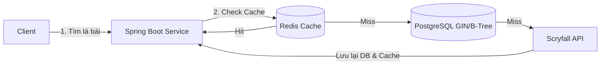
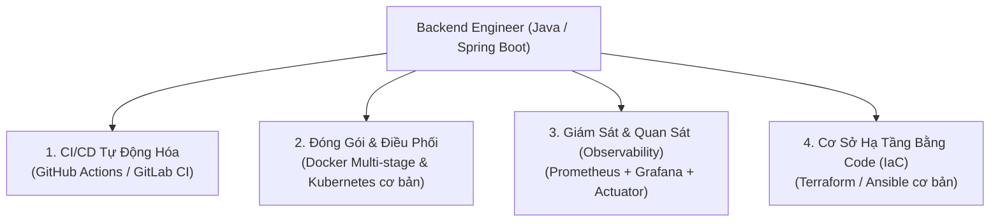

# TÀI LIỆU BỔ SUNG KIẾN THỨC BACKEND CHUYÊN SÂU & THỰC CHIẾN
> **Tài liệu đồng hành cùng bộ giáo trình `Code` (Java, Spring, PostgreSQL, Docker, CI/CD, Testing & Scryfall API)**  
> **Dự án mục tiêu:** `MtgChecker` (Spring Boot 3.3, Java 21, PostgreSQL, Redis, Docker)  
> **Mục đích:** Bổ sung những góc nhìn sâu nhất, các "cạm bẫy" kinh điển khi phỏng vấn Fresher/Junior và kỹ thuật tối ưu kiến trúc production.

---

## 📌 MỤC LỤC BỔ SUNG

1. [Phần 1: Bổ sung cho Java & Spring — Lombok Best Practices & Cạm bẫy Entity](#phần-1-bổ-sung-cho-java--spring--lombok-best-practices--cạm-bẫy-entity)
2. [Phần 2: Bổ sung cho Spring Data JPA — Vấn nạn N+1 Query & Khắc phục chuyên sâu](#phần-2-bổ-sung-cho-spring-data-jpa--vấn-nạn-n1-query--khắc-phục-chuyên-sâu)
3. [Phần 3: Bổ sung cho Spring AOP & Concurrency — Cạm bẫy @Transactional & Locking](#phần-3-bổ-sung-cho-spring-aop--concurrency--cạm-bẫy-transactional--locking)
4. [Phần 4: Bổ sung cho Vận hành & Review Code — Chuẩn Logging với @Slf4j](#phần-4-bổ-sung-cho-vận-hành--review-code--chuẩn-logging-với-slf4j)
5. [Phần 5: Bổ sung cho PostgreSQL Nâng cao — Bản chất Indexing & JSONB GIN Index](#phần-5-bổ-sung-cho-postgresql-nâng-cao--bản-chất-indexing--jsonb-gin-index)
6. [Phần 6: Bổ sung cho Scryfall REST API — Kiến trúc Caching & ETL Bulk Data](#phần-6-bổ-sung-cho-scryfall-rest-api--kiến-trúc-caching--etl-bulk-data)
7. [Phần 7: Bổ sung về Bảo mật — Cơ chế JWT, Token Versioning & Refresh Token Rotation](#phần-7-bổ-sung-về-bảo-mật--cơ-chế-jwt-token-versioning--refresh-token-rotation)
8. [Phần 8: Bổ sung về Design Patterns trong Spring Boot & Microservices](#phần-8-bổ-sung-về-design-patterns-trong-spring-boot--microservices)
9. [Phần 9: Bổ sung về Vận hành — Docker & Docker Compose Thực Chiến](#phần-9-bổ-sung-về-vận-hành--docker--docker-compose-thực-chiến)
10. [Phần 10: Chuyên sâu về Rate Limiting — Thuật toán Token Bucket & Trade-off Bộ nhớ RAM](#phần-10-chuyên-sâu-về-rate-limiting--thuật-toán-token-bucket--trade-off-bộ-nhớ-ram)
11. [Phần 11: Khắc phục Sự cố Thực tế (Troubleshooting & Real-World Bugs)](#phần-11-khắc-phục-sự-cố-thực-tế-troubleshooting--real-world-bugs)
12. [Phần 12: Kịch bản Phỏng vấn & Thuyết trình Dự án MtgChecker](#phần-12-kịch-bản-phỏng-vấn--thuyết-trình-dự-án-mtgchecker)
13. [Phần 13: Ba Tình Huống Thực Chiến Sống Còn (Production Scenarios)](#phần-13-ba-tình-huống-thực-chiến-sống-còn-production-scenarios)
14. [Phần 14: Kiến trúc Mạng Máy tính Dành cho Backend (Computer Networking for Backend Engineers)](#phần-14-kiến-trúc-mạng-máy-tính-dành-cho-backend-computer-networking-for-backend-engineers)
15. [Phần 15: Lộ Trình Phát Triển Kỹ Năng DevOps Thực Chiến Cho Backend Engineer](#phần-15-lộ-trình-phát-triển-kỹ-năng-devops-thực-chiến-cho-backend-engineer)
16. [Phần 16: Bộ câu hỏi phỏng vấn "Xoáy" (Mock Interview Q&A)](#phần-16-bộ-câu-hỏi-phỏng-vấn-xoáy-mock-interview-qa)

---

## PHẦN 1: BỔ SUNG CHO JAVA & SPRING — LOMBOK BEST PRACTICES & CẠM BẪY ENTITY

Tài liệu gốc `03 - Spring.docx` và `02 - Hibernate.docx` đã nêu rõ về ORM và DI, nhưng trong dự án thực tế sử dụng Lombok, có những quy tắc "sống còn" sau:

### 1.1. Cấm dùng `@Data` trên `@Entity`
* **Nguyên nhân:** `@Data` tự động sinh ra `@ToString` và `@EqualsAndHashCode` trên toàn bộ các trường.
* **Hậu quả 1 (StackOverflowError):** Nếu 2 Entity có quan hệ hai chiều (`@OneToMany` - `@ManyToOne`), việc `toString()` hoặc `hashCode()` sẽ gọi chéo nhau vô tận -> Tràn stack, sập ứng dụng.
* **Hậu quả 2 (Phá vỡ Lazy Loading):** `toString()` đọc các quan hệ `FetchType.LAZY`, ép Hibernate kích hoạt truy vấn ngầm ngoài ý muốn, làm chậm toàn hệ thống hoặc văng `LazyInitializationException`.
* **Hậu quả 3 (Lỗi Set / Map với ID):** Khi Entity mới tạo chưa có ID (id = null), sau khi `persist()` thì ID được gán giá trị thật. Nếu `hashCode()` phụ thuộc ID, vị trí của Entity trong `HashSet` hoặc `HashMap` sẽ bị sai lệch hoàn toàn.
* **Chuẩn áp dụng cho Entity:**
  ```java
  @Getter
  @Setter
  @NoArgsConstructor
  @AllArgsConstructor
  @Entity
  @Table(name = "cards")
  public class CardEntity {
      @Id
      @GeneratedValue(strategy = GenerationType.UUID)
      private UUID id;
      
      // Không dùng @Data!
  }
  ```

### 1.2. Chuẩn Dependency Injection: `@RequiredArgsConstructor`
* Trong `03 - Spring.docx` đã khuyên dùng **Constructor Injection** thay cho `@Autowired` trên field.
* Để code cực kỳ ngắn gọn và sạch, kết hợp `final` với `@RequiredArgsConstructor`:
  ```java
  @Service
  @RequiredArgsConstructor // Tự sinh constructor chứa mọi field 'final'
  public class CardService {
      private final CardRepository cardRepository;
      private final RedisTemplate<String, Object> redisTemplate;
  }
  ```

---

## PHẦN 2: BỔ SUNG CHO SPRING DATA JPA — VẤN NẠN N+1 QUERY & KHẮC PHỤC CHUYÊN SÂU

Trong tài liệu `02 - Hibernate.docx`, khái niệm N+1 query chỉ được nhắc sơ lược. Dưới đây là bức tranh toàn cảnh:

### 2.1. Bản chất N+1 Query
* Bạn lấy 1 danh sách gồm $N$ bộ bài (`Deck`).
* Khi duyệt qua từng `Deck` để lấy danh sách lá bài (`cards`), Hibernate phát sinh thêm $N$ câu lệnh `SELECT` phụ.
* Tổng số truy vấn: $1 + N$ (nếu có 1.000 deck, ứng dụng bắn 1.001 truy vấn xuống Database).

### 2.2. Ba phương pháp đặc trị trong Spring Boot
1. **Dùng `JOIN FETCH` trong JPQL:**
   ```java
   @Query("SELECT d FROM Deck d JOIN FETCH d.cards WHERE d.user.id = :userId")
   List<Deck> findAllWithCards(@Param("userId") Long userId);
   ```
2. **Dùng `@EntityGraph` (Chuẩn Spring Data JPA):**
   * Cho phép định nghĩa đồ thị dữ liệu cần eager fetch linh hoạt mà không cần đổi câu query JPQL:
   ```java
   @EntityGraph(attributePaths = {"cards", "user"})
   List<Deck> findByIsPublicTrue();
   ```
   * *Phân biệt:* 
     * `EntityGraphType.FETCH` (mặc định): Các thuộc tính được chỉ định là `EAGER`, các thuộc tính còn lại bị ép thành `LAZY`.
     * `EntityGraphType.LOAD`: Các thuộc tính được chỉ định là `EAGER`, các thuộc tính còn lại giữ nguyên fetch type đã khai báo trên Entity.
3. **Cấu hình `default_batch_fetch_size` (Tấm lưới an toàn toàn cục):**
   ```yaml
   spring:
     jpa:
       properties:
         hibernate:
           default_batch_fetch_size: 50
   ```
   * Biến $N$ câu `SELECT` lẻ tẻ thành 1 câu duy nhất dùng `WHERE deck_id IN (?, ?, ..., ?)`.

### 2.3. Bóc trần Bản chất Hiệu năng: Spring Data JPA (Hibernate) vs JDBC Thuần
* **Tại sao 90% dự án công ty vẫn dùng JPA dù chậm hơn JDBC?**
  1. **Năng suất Lập trình (Developer Productivity):** JPA giải phóng lập trình viên khỏi việc viết hàng ngàn dòng SQL lặp đi lặp lại. Các hàm CRUD cơ bản (`save`, `findById`, `delete`) được sinh tự động trong 0 giây.
  2. **An toàn Hướng Đối Tượng (Type-Safety & Refactor):** Đổi tên thuộc tính trong Entity Java, trình biên dịch bắt lỗi ngay lập tức. Trong khi JDBC viết chuỗi SQL ("SELECT card_name..."), nếu Database đổi tên cột thì chỉ khi chạy ứng dụng (Runtime) mới nổ lỗi.
  3. **Tự động Quản lý Giao dịch & Dirty Checking:** Chỉ cần `card.setPrice(100)`, khi kết thúc transaction Hibernate tự so sánh bản chụp (Snapshot) trong First-Level Cache và sinh câu `UPDATE` chính xác.
* **Tại sao JPA chạy chậm hơn JDBC (Chi phí Ẩn - Overhead):**
  - **First-Level Cache (Persistence Context):** Phải lưu giữ 2 bản sao của mỗi Entity trong RAM để dirty checking.
  - **Reflection & Metamodel:** Tốn CPU phân tích các annotation `@ManyToOne`, `@OneToMany` khi ánh xạ từ JDBC ResultSet sang Java Object.
  - **Nguy cơ N+1:** Cơ chế `FetchType.LAZY` tự phát sinh truy vấn ngầm nếu không kiểm soát bằng `@EntityGraph`.
* **Chiến lược Lai (Hybrid Architecture) Chuẩn Doanh nghiệp:**
  - **85% Tác vụ Nghiệp vụ (OLTP - CRUD, Auth, User, Deck):** Dùng **Spring Data JPA** để code nhanh, sạch, dễ bảo trì.
  - **15% Tác vụ Nặng (Batch Processing, Báo cáo Thống kê, Bulk Data):** Dùng **`JdbcTemplate`** hoặc **MyBatis** để ép xung hiệu năng tối đa.

---

## PHẦN 3: BỔ SUNG CHO SPRING AOP & CONCURRENCY — CẠM BẪY @TRANSACTIONAL & LOCKING

### 3.1. Cạm bẫy "Nuốt Exception" với `try-catch` trong `@Transactional`
* **Cơ chế:** `@Transactional` hoạt động nhờ Spring AOP Proxy bọc bên ngoài method. Proxy chỉ kích hoạt rollback khi **bắt được Exception văng ra ngoài**.
* **Sai lầm phổ biến:**
  ```java
  @Transactional
  public void buyCard(Long cardId, Long userId) {
      deductMoney(userId);
      try {
          updateCardInventory(cardId); // Lỗi xảy ra ở đây!
      } catch (Exception e) {
          log.error("Lỗi cập nhật kho bài", e);
          // Nuốt lỗi! Phương thức kết thúc êm xuôi!
      }
      // HẬU QUẢ: Spring tưởng thành công -> COMMIT! Tiền bị trừ nhưng kho không đổi!
  }
  ```
* **Giải pháp chuẩn:**
  1. **Re-throw exception:**
     ```java
     catch (Exception e) {
         log.error("Lỗi khi mua card: {}", e.getMessage(), e);
         throw new BusinessException("Giao dịch mua bài thất bại", e);
     }
     ```
  2. **Báo thủ công cho Transaction Coordinator:**
     ```java
     catch (Exception e) {
         log.error("Giao dịch lỗi", e);
         TransactionAspectSupport.currentTransactionStatus().setRollbackOnly();
     }
     ```

### 3.2. Quy tắc Rollback: Checked vs Unchecked
* Mặc định, Spring **chỉ rollback** với `RuntimeException` và `Error` (Unchecked Exception).
* Nếu ném ra `Exception` (Checked Exception, ví dụ `IOException`, `SQLException`), Spring **mặc định KHÔNG rollback**!
* **Cách khắc phục:** Luôn khai báo rõ:
  ```java
  @Transactional(rollbackFor = Exception.class)
  ```

### 3.3. Xử lý Tranh chấp dữ liệu (Concurrency Control): Optimistic vs Pessimistic
Khi 2 người dùng cùng lúc bấm mua lá bài hiếm cuối cùng:

| Tiêu chí | Optimistic Locking (Khóa lạc quan) | Pessimistic Locking (Khóa bi quan) |
| :--- | :--- | :--- |
| **Bản chất** | Không khóa DB, dùng số hiệu phiên bản (`@Version`). | Khóa cứng hàng dữ liệu trong DB (`SELECT FOR UPDATE`). |
| **Cách hoạt động** | `UPDATE cards SET quantity = 0, version = version + 1 WHERE id = 1 AND version = 5`. Nếu bản ghi đã bị người khác đổi version trước đó -> văng `OptimisticLockException`. | Hàng dữ liệu bị khóa độc quyền cho tới khi transaction kết thúc; người sau phải xếp hàng đợi. |
| **Hiệu năng** | Cực cao khi ít xung đột (Read-heavy). | Thấp hơn, tốn tài nguyên DB connection nếu giữ khóa lâu. |
| **Nguy cơ Deadlock** | Không có Deadlock ở DB. | Có nguy cơ Deadlock nếu lấy khóa chéo nhau. |
| **Trường hợp áp dụng** | Ứng dụng xem/duyệt bài MTG, cập nhật hồ sơ người dùng, quản lý deck cá nhân. | Thanh toán tiền, trừ tồn kho hàng flash sale, đổi vé độc quyền. |

---

## PHẦN 4: BỔ SUNG CHO VẬN HÀNH & REVIEW CODE — CHUẨN LOGGING VỚI @SLF4J

Tài liệu `Kiểm thử và review` nhấn mạnh việc đọc diff, nhưng thiếu tiêu chuẩn ghi log trong production:

### 4.1. Tại sao cấm dùng `System.out.println`?
1. **Đồng bộ và chặn luồng (Synchronous Blocking):** `System.out` dùng `synchronized` nội bộ, làm nghẽn luồng xử lý của server khi có nhiều request đồng thời.
2. **Không có Log Level:** Không thể bật/tắt theo môi trường (Dev cần debug, Production chỉ cần Info/Warn/Error).
3. **Không ghi file & Xoay vòng (Rotation):** Log in ra console sẽ mất khi restart container và không chia file theo ngày/dung lượng.

### 4.2. Chuẩn ghi log với `@Slf4j`
* Dùng **Parameterized Logging `{}`** để tránh tốn CPU nối chuỗi khi log level bị tắt:
  ```java
  // Đúng: Không tốn CPU nối chuỗi nếu DEBUG đang tắt
  log.debug("Đang xử lý lá bài có id: {} và set: {}", cardId, setCode);

  // Sai: Chuỗi bị nối trước khi truyền vào hàm
  log.debug("Đang xử lý lá bài có id: " + cardId + " và set: " + setCode);
  ```
* Bắt buộc truyền đối tượng `Exception` vào tham số cuối cùng để in đầy đủ Stack Trace:
  ```java
  log.error("Lỗi khi đồng bộ Scryfall API: {}", e.getMessage(), e);
  ```

---

## PHẦN 5: BỔ SUNG CHO POSTGRESQL NÂNG CAO — BẢN CHẤT INDEXING & JSONB GIN INDEX

Tài liệu `04 - Nâng cao\02 - JSONB và kiểu riêng.docx` và `03 - Trung cấp\01 - View và index.docx` của PostgreSQL có thể bổ sung những điểm mấu chốt sau:

### 5.1. So sánh 5 cấu trúc Index quan trọng
1. **B-Tree (Mặc định):** Cây cân bằng, tối ưu cho tìm kiếm chính xác (`=`), so sánh khoảng (`<`, `>`, `BETWEEN`), và sắp xếp (`ORDER BY`).
2. **Hash Index:** Cực nhanh cho so sánh chính xác (`=`), độ phức tạp $O(1)$, nhưng không hỗ trợ tìm kiếm khoảng hoặc `ORDER BY`.
3. **GIN (Generalized Inverted Index):** Chỉ mục đảo ngược. **Vũ khí tối thượng cho cột `JSONB`, mảng (`array`), và Full-Text Search**.
4. **GiST (Generalized Search Tree):** Tối ưu cho dữ liệu hình học, tọa độ GPS (GIS), và dữ liệu dạng khoảng (`tsrange`).
5. **LSM-Tree (Log-Structured Merge-Tree):** Dùng trong các NoSQL/K-V Store (RocksDB, Cassandra), tối ưu hóa tốc độ ghi cực nhanh (Write-heavy).

### 5.2. Ứng dụng GIN Index cho Dữ liệu Scryfall Card trong PostgreSQL
Mỗi lá bài Scryfall trả về một JSON rất phức tạp (giá, legalities, keywords, faces...). Lưu dạng `JSONB` và tạo **GIN Index**:
```sql
-- Tạo bảng lưu card dạng JSONB
CREATE TABLE scryfall_cards (
    id UUID PRIMARY KEY,
    oracle_id UUID,
    name VARCHAR(255),
    raw_data JSONB
);

-- Tạo GIN Index trên toàn bộ cấu trúc JSONB
CREATE INDEX idx_scryfall_raw_data_gin ON scryfall_cards USING gin (raw_data);

-- Truy vấn siêu tốc bằng toán tử JSON containment (@>):
SELECT name FROM scryfall_cards 
WHERE raw_data @> '{"legalities": {"commander": "legal"}, "keywords": ["Flying"]}';
```

### 5.3. Quy tắc Leftmost Prefix (Tiền tố ngoài cùng bên trái) với Composite Index
Nếu bạn tạo index trên 3 cột `(set_code, rarity, card_name)`:
* ✅ `WHERE set_code = 'MH3'` -> **Dùng được Index**.
* ✅ `WHERE set_code = 'MH3' AND rarity = 'mythic'` -> **Dùng được Index**.
* ❌ `WHERE rarity = 'mythic'` -> **KHÔNG dùng được Index** (Bị quét toàn bảng - Seq Scan).
* ❌ `WHERE card_name = 'Ragavan'` -> **KHÔNG dùng được Index**.

---

## PHẦN 6: BỔ SUNG CHO SCRYFALL REST API — KIẾN TRÚC CACHING & ETL BULK DATA

Tài liệu `Scryfall REST API — Chi tiết endpoint và công dụng.docx` liệt kê 49 endpoint rất chi tiết. Khi áp dụng vào dự án backend `MtgChecker`, cần kiến trúc như sau:

### 6.1. Xử lý Rate Limiting (Tránh mã lỗi HTTP 429)
* Scryfall giới hạn 2 req/s cho `/cards/search` và 10 req/s cho các method khác.
* **Chiến lược:**
  1. Sử dụng **Bucket4j** hoặc **Resilience4j RateLimiter** trong Spring Boot để giới hạn tốc độ client trước khi gửi đi.
  2. Xử lý **Exponential Backoff**: Nếu gặp HTTP 429, tạm dừng (sleep) tối thiểu $30$ giây trước khi retry.

### 6.2. Chiến lược 2-Layer Cache (Redis + PostgreSQL)

* **Dữ liệu bài & giá:** Giá bài chỉ cập nhật 1 lần/ngày -> Đặt Redis TTL = 24h.
* **Bulk Data Job (ETL):** Không gọi từng request đơn lẻ. Lên lịch (Spring `@Scheduled`) mỗi đêm gọi `GET /bulk-data/default-cards` tải file `.jsonl.gz`, giải nén và dùng PostgreSQL `COPY` hoặc Spring Batch `NamedParameterJdbcTemplate.batchUpdate()` để ghi hàng trăm ngàn lá bài chỉ trong vài giây.

---

## PHẦN 7: BỔ SUNG VỀ BẢO MẬT — CƠ CHẾ JWT, TOKEN VERSIONING & REFRESH TOKEN ROTATION

### 7.1. Cấu trúc 3 phần của JWT và Cạm bẫy Base64
* **Header . Payload . Signature**: Payload chỉ encode dạng Base64Url (công khai hai chiều), **KHÔNG PHẢI MÃ HÓA (ENCRYPTION)**. Cấm tuyệt đối lưu password, mã PIN hoặc dữ liệu nhạy cảm trong Payload.
* **Cặp bài trùng Access Token & Refresh Token**:
  * Access Token: TTL ngắn (15 phút), đính kèm `Authorization: Bearer <token>` mỗi request.
  * Refresh Token: TTL dài (7-30 ngày), chỉ dùng để gọi `/api/auth/refresh` cấp lại token mới.

### 7.2. Giải pháp Đăng xuất (Logout) và Cập nhật Quyền tức thì
* **Logout với Redis Blacklist**: Lưu token bị hủy vào Redis với TTL bằng thời gian sống còn lại của token.
* **Cơ chế Token Versioning**:
  * Lưu trường `token_version` (int) trong DB và đưa vào claims của JWT.
  * Khi Admin đổi Role, đổi mật khẩu hoặc khóa tài khoản: tăng `token_version = token_version + 1` ở DB/Redis.
  * Trong `JwtAuthenticationFilter`, so khớp version trong token với DB/Redis. Nếu lệch -> Bắn lỗi `401 Unauthorized` ngay lập tức.
  * Client sử dụng Axios Interceptor bắt mã 401 để tự động gọi Refresh Token lấy bộ token mới mang quyền mới mà không cần người dùng đăng nhập lại.

---

## PHẦN 8: BỔ SUNG VỀ DESIGN PATTERNS TRONG SPRING BOOT & MICROSERVICES

### 8.1. 5 Design Patterns GoF cốt lõi trong Spring Boot
1. **Singleton Pattern**:
   * Mọi Spring Bean (`@Service`, `@Repository`, `@Component`) mặc định có `scope = singleton`.
   * Khác biệt GoF: GoF Singleton là 1 instance trên toàn bộ JVM; Spring Singleton là 1 instance trong một `ApplicationContext`.
   * Cạm bẫy: Cấm lưu user state vào field của Service singleton để tránh Race Condition.
2. **Builder Pattern**:
   * Annotation `@Builder` của Lombok trên các DTO/Response và `Jwts.builder()` trong `JwtUtil`.
   * Giúp tạo object bất biến (immutable), tránh cạm bẫy truyền sai thứ tự tham số constructor.
3. **Proxy Pattern (AOP & @Transactional)**:
   * Spring dùng CGLIB Dynamic Proxy tạo lớp vỏ bọc bên ngoài Bean thật.
   * Khi gọi `vinhService.tiencong()`, Controller gọi vào Proxy -> Proxy mở transaction (`beginTransaction`) -> gọi hàm thật -> Commit/Rollback.
   * Lời gọi nội bộ qua `this.tiencong()` không đi qua Proxy nên `@Transactional` bị vô hiệu hóa!
4. **Chain of Responsibility**:
   * Chuỗi Security Filter: `RateLimitFilter` -> `JwtAuthenticationFilter` -> `UsernamePasswordAuthenticationFilter`.
   * Mỗi bộ lọc xử lý một khâu, đạt điều kiện thì gọi `filterChain.doFilter(request, response)` để chuyển tiếp.
5. **Adapter Pattern**:
   * Class `CustomUserDetails implements UserDetails`: bọc entity `Account` của dự án thành chuẩn `UserDetails` mà Spring Security yêu cầu.

### 8.2. Microservices Patterns kinh điển
* **API Gateway**: Cổng duy nhất định tuyến, check JWT và rate limit tập trung.
* **Service Discovery (Eureka/Consul)**: Danh bạ định vị IP động của các service.
* **Circuit Breaker (Resilience4j)**: Cầu dao tự ngắt (Closed -> Open -> Half-Open) chống sập dây chuyền (Cascading failure).
* **Saga Pattern**: Quản lý giao dịch phân tán qua chuỗi Local Transactions và Giao dịch bù trừ (Compensating Transactions).
* **CQRS**: Tách rời hoàn toàn luồng Ghi (PostgreSQL) và luồng Đọc/Tìm kiếm (Elasticsearch/Redis).

---

## PHẦN 9: BỔ SUNG VỀ VẬN HÀNH — DOCKER & DOCKER COMPOSE THỰC CHIẾN

### 9.1. Multi-stage Build trong Spring Boot (Tối ưu Image từ 800MB xuống 180MB)
* **Stage 1 (Build):** Dùng image `maven` hoặc `jdk` đầy đủ để tải dependency và biên dịch ra file `.jar`.
* **Stage 2 (Runtime):** Chỉ dùng image `jre` gọn nhẹ (ví dụ `eclipse-temurin:21-jre-jammy`), copy duy nhất 1 file `.jar` từ Stage 1 sang.
* **Lợi ích kép:**
  * Giảm kích thước image hơn 4 lần -> kéo/đẩy và deploy siêu tốc.
  * Bảo mật cao: Không để lộ source code, không có trình biên dịch `javac` trên Production.
  * Chạy bằng **Non-root user** (`USER app`) để chống leo thang đặc quyền khi bị tấn công.

### 9.2. Docker Compose & Cơ chế Giao tiếp Mạng Nội bộ
* **Service Discovery qua DNS:** Trong file `docker-compose.yml`, tên các service (`db`, `redis`, `app`) đóng vai trò là domain name. Spring Boot kết nối Postgres bằng URL `jdbc:postgresql://db:5432/...` nhờ DNS nội bộ của Docker Bridge Network tự giải mã IP.
* **Healthcheck & Depends_on condition:**
  * `depends_on` thông thường chỉ đợi container khởi động (started), dễ làm Spring Boot sập vì Postgres chưa mở port nhận kết nối.
  * Kết hợp `condition: service_healthy` với `healthcheck: pg_isready` ép Spring Boot chỉ được khởi động khi Database đã sẵn sàng 100%.
* **Data Persistence (Named Volume):** Khai báo Volume ngoài (`mtgchecker_pgdata:/var/lib/postgresql/data`) để khi xóa container (`docker compose down`) dữ liệu thẻ bài và người dùng không bị mất.
* **Cấu hình RAM thông minh trong Container:** Dùng `-XX:MaxRAMPercentage=75.0` thay vì fix cứng `-Xmx` để JVM tự co giãn theo tài nguyên container được cấp, tránh lỗi Linux OOMKilled (Exit code 137).

### 9.3. Triết lý Thiết kế Container & Bản chất WSL 2 trên Windows
1. **Giải quyết vấn đề kinh điển "It works on my machine":**
   * Ngày xưa, máy dev chạy Windows, máy tester chạy macOS, server deploy chạy Linux CentOS $\longrightarrow$ Lệch phiên bản thư viện C, khác biệt đường dẫn file (`\` vs `/`), khác biệt biến môi trường khiến code liên tục bị lỗi khi bàn giao.
   * Container đóng gói toàn bộ: **Mã nguồn + Môi trường thực thi (JRE) + Thư viện hệ điều hành (Alpine/Debian)** thành một khối bất biến (Image). Chạy trên máy nào cũng ra đúng một kết quả duy nhất 100%.
2. **Cơ chế WSL 2 (Windows Subsystem for Linux) trên Windows:**
   * Linux Container cần Linux Kernel để hoạt động. Trên Windows, Docker Desktop sử dụng một máy ảo Linux siêu nhẹ (Micro-VM) tên là WSL 2 do Microsoft phát triển riêng, khởi động trong 1 giây và chia sẻ tài nguyên trực tiếp với Windows Host.
   * Trên server production chạy Linux thật, Docker chạy trực tiếp trên bare-metal kernel, không cần qua lớp máy ảo nào.
3. **Bảo mật và Cô lập Vùng nguy hiểm (Sandboxing & Blast Radius):**
   * Nếu chạy app trực tiếp trên máy host, khi hacker khai thác được lỗ hổng Remote Code Execution (RCE), chúng sẽ chiếm luôn toàn bộ ổ đĩa `C:\`, `D:\` của máy tính.
   * Khi đóng gói trong Container với **Non-root user (`USER app`)**: Hacker bị nhốt trong một "chiếc hộp cát" (Sandbox). Container không có quyền truy cập vào file hệ thống của máy thật, ngăn chặn 100% nguy cơ hacker leo thang đặc quyền chiếm quyền máy chủ.

---

## PHẦN 10: CHUYÊN SÂU VỀ RATE LIMITING — THUẬT TOÁN TOKEN BUCKET & TRADE-OFF BỘ NHỚ RAM

### 10.1. Bản chất của Bucket4j & Thuật toán Token Bucket
* **Toàn bộ tính toán diễn ra trên RAM:** Bucket4j sử dụng cấu trúc toán học cực kỳ tối ưu. Nó **KHÔNG dùng background thread** để rót nước định kỳ (vì dùng thread đếm giờ sẽ làm sập CPU khi có hàng triệu xô). Thay vào đó, nó dùng công thức tính toán độ lệch thời gian:
  $$\text{Tokens mới} = (\text{Thời điểm hiện tại} - \text{Thời điểm request trước}) \times \text{Tốc độ rót (Refill Rate)}$$
* **Chi phí bộ nhớ RAM thực tế:**
  - Mỗi Bucket trong `ConcurrentHashMap` chỉ chiếm khoảng **120 - 150 bytes** RAM.
  - 10.000 người dùng đồng thời chỉ tốn khoảng **1.5MB RAM** (con số cực kỳ nhỏ so với 1-2GB RAM của server).
  - Tuy nhiên, cạm bẫy lớn nhất là **Memory Leak (Rò rỉ bộ nhớ do IP rác)**: Nếu hàng trăm nghìn bot spam gửi request rồi không bao giờ quay lại, các key IP đó sẽ nằm vĩnh viễn trong HashMap trên RAM nếu không có cơ chế dọn dẹp (TTL / Eviction).

### 10.3. Bốn Vũ khí Tối thượng của Redis giúp Triệt tiêu Out of Memory (OOM)
1. **Cơ chế Hết hạn Tự động (TTL - Time-To-Live):**
   * Trong Java `ConcurrentHashMap`, một key được tạo ra sẽ nằm đó vĩnh viễn trừ khi tự viết thread dọn dẹp (rất tốn CPU và dễ sinh lỗi lock).
   * Trong Redis, mỗi key được gắn hạn sống (ví dụ `EXPIRE bucket:ip 300` - 5 phút). Redis sử dụng kết hợp 2 giải thuật: **Passive Expiry** (khi có request truy cập key cũ thì xóa ngay) và **Active Expiry** (quét ngẫu nhiên các key hết hạn trong nền) để giải phóng RAM tự động.
2. **Chiến lược Thu hồi Bộ nhớ (Memory Eviction Policy - `allkeys-lru`):**
   * Đã cấu hình ngay trong `docker-compose.yml` của dự án:
     ```yaml
     command: redis-server --maxmemory 256mb --maxmemory-policy allkeys-lru
     ```
   * Khi bot spam hàng triệu IP khiến RAM đạt trần 256MB, Redis **KHÔNG BAO GIỜ BỊ CRASH/SẬP OOM**. Nó kích hoạt giải thuật **LRU (Least Recently Used)**: tự động vứt bỏ các IP cũ nhất, ít truy cập nhất để nhường chỗ cho IP mới.
3. **Hiệu năng Cực hạn với Đơn Luồng (Single-Threaded Event Loop):**
   * Redis xử lý dữ liệu in-memory thuần túy bằng ngôn ngữ C, phục vụ hơn 100.000 ops/giây với độ trễ $< 1$ms.
   * Kiến trúc Single-Threaded loại bỏ hoàn toàn chi phí chuyển đổi ngữ cảnh (Context Switching) và hiện tượng khóa tranh chấp (Thread Lock Contention) giữa hàng ngàn luồng Java.
4. **Phân tách Ranh giới Tài nguyên (Decoupling Application & Cache):**
   * Nếu lưu xô trong JVM RAM, khi có sự cố bộ nhớ thì tiến trình Java của Spring Boot sập hoàn toàn (Sập cả App).
   * Khi đẩy sang Redis, Redis là một tiến trình/container độc lập. Kể cả Redis chạm trần RAM, Spring Boot vẫn sống sót và hoạt động bình thường.

### 10.4. Cơ chế Đỉnh cao: Làm sao Redis biết chính xác Key nào là "Rác" mà không cần quét tuần tự?
1. **Sự kết hợp giữa 2 cơ chế dọn dẹp TTL (Passive + Active Expiry):**
   * **Cơ chế 1 - Bắt quả tang khi truy cập (Passive Expiry - 100% chính xác):** Khi bất kỳ request nào chạm vào một key, Redis liếc nhìn mốc `expire_at`. Nếu thời gian hiện tại $> \text{expire\_at}$, Redis xóa key đó ngay lập tức và trả về `nil`. Không tốn một giọt tài nguyên nào trước đó.
   * **Cơ chế 2 - Thuật toán Quét xác suất theo chu kỳ (Active Probabilistic Expiry):**
     - Cứ mỗi $100$ms (10 lần/giây), Redis chọn ngẫu nhiên $20$ key có gắn TTL.
     - Xóa tất cả các key đã hết hạn trong số $20$ key đó.
     - Nếu tỉ lệ key hết hạn $> 25\%$ (tức $> 5$ key bị xóa), Redis lặp lại chu kỳ quét ngay lập tức.
     - 👉 **Nguyên lý thống kê toán học:** Bằng cách lặp lại việc lấy mẫu ngẫu nhiên khi tỉ lệ rác còn cao, Redis đảm bảo tỉ lệ key rác chưa xóa trong toàn bộ bộ nhớ **luôn luôn dưới 25%** mà chỉ tốn không quá 1ms CPU!
2. **Thuật toán Xấp xỉ LRU (Approximated LRU Algorithm) khi đầy RAM (`allkeys-lru`):**
   * Trong mỗi Object lưu trong Redis, nó dành ra **24 bits** để lưu mốc thời gian truy cập cuối cùng (`lru_clock`).
   * Khi RAM chạm ngưỡng `maxmemory 256mb`:
     - Redis **chọn ngẫu nhiên 5 keys** (mặc định `maxmemory-samples 5`).
     - So sánh `lru_clock` của 5 keys này và **chọn ra key có thời gian ngủ yên lâu nhất (cũ nhất)** để đuổi (evict) khỏi bộ nhớ!
     - Kỹ thuật xấp xỉ này cho kết quả chính xác tương đương 99% so với việc sắp xếp toàn bộ hàng triệu keys, nhưng tốn $O(1)$ CPU và $0$ bytes bộ nhớ phụ!

---

## PHẦN 11: KHẮC PHỤC SỰ CỐ THỰC TẾ (TROUBLESHOOTING & REAL-WORLD BUGS)

### 10.1. Cạm bẫy "Failed to Fetch / CORS / Network Failure" trên Swagger UI & Mobile App
* **Bản chất lỗi trên trình duyệt / Swagger:**
  - Trình duyệt hiển thị: `"Failed to fetch. Possible Reasons: CORS, Network Failure, URL scheme must be http or https"`.
  - **Nguyên nhân gốc rễ 1 (Lệch Cổng / Cấu hình Server URL cứng):** 
    - Khi chạy Docker, máy chủ host map cổng `8081:8080` (truy cập bằng `http://localhost:8081/swagger-ui.html`).
    - Nhưng trong cấu hình OpenAPI/Swagger trước đó khai báo cứng: `serverUrl = "http://localhost:8080"`.
    - Kết quả: Swagger UI tải từ cổng `8081` nhưng khi bấm "Execute" lại gửi request sang cổng `8080`. Không có service nào lắng nghe ở `8080` -> Trình duyệt bị **Network Failure (ERR_CONNECTION_REFUSED)**. Trình duyệt không nhận được response nên phỏng đoán lỗi thành CORS.
    - **Giải pháp dứt điểm:** Trong `OpenApiConfig.java`, dùng Relative URL `new Server().url("/")`. Swagger UI sẽ tự động gửi request đến đúng Host, Port và Protocol mà trình duyệt đang mở.
  - **Nguyên nhân gốc rễ 2 (Xung đột `allowedOrigins("*")` và `allowCredentials(true)`):**
    - Chuẩn CORS W3C quy định: Nếu bật `allowCredentials(true)` (cho phép gửi Cookie/Header Authorization), thì **KHÔNG ĐƯỢC PHÉP** để `allowedOrigins("*")`. Trình duyệt sẽ chặn đứng request ngay lập tức vì lý do bảo mật.
    - **Giải pháp dứt điểm:** Trong `CorsConfig.java`, dùng `configuration.setAllowedOriginPatterns(List.of("*"))` của Spring Framework. Hàm này cho phép dùng wildcard an toàn mà không vi phạm quy tắc credential của W3C.

### 10.2. Cạm bẫy Race Condition trên Frontend Mobile (React Native / Expo)
* **Lỗi kinh điển:** `TypeError: Cannot read property 'name' of undefined` trong `CreateDeckModal.tsx`.
* **Nguyên nhân:** Khi Modal vừa mở (mount), request lấy danh sách `formats` từ server vẫn đang bay trên mạng (bất đồng bộ). State `formats` ban đầu là mảng rỗng `[]`. Khi truy cập `formats[0].name` hoặc `selectedFormat.name` thì `selectedFormat` bị `undefined`.
* **Giải pháp chuẩn:**
  1. Luôn có `DEFAULT_FALLBACK_FORMAT` tại chỗ để hiển thị ngay lập tức.
  2. Dùng Optional Chaining và giá trị dự phòng: `{selectedFormat?.name || 'Commander'}`.
  3. Dùng `useEffect` đồng bộ lại `selectedFormatId` khi danh sách formats từ server trả về.

---

## PHẦN 12: KỊCH BẢN PHỎNG VẤN & THUYẾT TRÌNH DỰ ÁN MTGCHECKER

### 12.1. Kịch bản "Pitching" 2 phút mở đầu gây ấn tượng mạnh
1. **Bài toán & Nghiệp vụ:** *"MtgChecker là hệ sinh thái quản lý bộ sưu tập và tối ưu deck cho game Magic: The Gathering, tích hợp 49 endpoints Scryfall API và hệ thống Trọng tài AI hỗ trợ luật thi đấu."*
2. **Thách thức Kỹ thuật & Giải pháp:**
   * **Database & Caching:** Dùng PostgreSQL cột `JSONB` kết hợp **GIN Index** và **Trigram Index (`pg_trgm`)** cho tìm kiếm autocomplete < 2ms; 2-Layer Cache với **Redis** (TTL 24h) và ETL Bulk Data sync stream nạp hàng chục nghìn thẻ bài.
   * **Concurrency:** Dùng **Pessimistic Locking (`SELECT FOR UPDATE`)** xử lý kho bài chống overselling; giải quyết N+1 query bằng `@EntityGraph`.
   * **Bảo mật:** Dynamic Multi-role RBAC, cơ chế **Token Versioning** và **Refresh Token Rotation** trên Spring Security JWT để thu hồi quyền tức thời.
   * **Vận hành:** Đóng gói **Multi-stage Dockerfile** (~180MB) và điều phối qua `docker-compose` có `healthcheck` liên kết `db`, `redis`, `app`.

---

## PHẦN 13: BA TÌNH HUỐNG THỰC CHIẾN SỐNG CÒN (PRODUCTION SCENARIOS)

### 13.1. Tình huống 1: Chuẩn hóa Xử lý Lỗi Toàn cục (`GlobalExceptionHandler`)
* **Bản chất kiến trúc:** 
  - Không bọc `try-catch` lắt nhắt ở từng Controller.
  - Sử dụng `@RestControllerAdvice` đóng vai trò là một AOP Interceptor đứng chắn toàn cục.
* **Nguyên tắc vàng bảo mật:**
  1. Tuyệt đối không để lộ Java Stack Trace (`NullPointerException`, tên class, dòng code) ra client vì nguy cơ lộ cấu trúc hệ thống.
  2. Log chi tiết trong nội bộ server bằng `@Slf4j` (log.error kèm đối tượng exception).
  3. Chuẩn hóa format trả về theo chuẩn **RFC 7807 (Problem Details)**: `timestamp`, `status`, `error`, `message`.
  4. Bổ sung trạm hứng cuối cùng: `@ExceptionHandler(Exception.class)` để bắt các lỗi không lường trước, trả về HTTP 500 thân thiện: *"Đã có sự cố xảy ra, vui lòng thử lại sau"*.

### 13.2. Tình huống 2: Quản lý Phiên bản Cơ sở Dữ liệu (Database Migration - Flyway)
* **Cạm bẫy `hibernate.ddl-auto: update`:**
  - Không bao giờ dùng trên Production vì Hibernate có thể tự động sửa cột, làm mất dữ liệu, hoặc sinh ra khóa chết bảng (Table Lock).
  - Không theo dõi được lịch sử thay đổi cấu trúc bảng giữa các thành viên trong team.
* **Chuẩn Enterprise với Flyway:**
  - Cấu hình Hibernate: `ddl-auto: validate` (chỉ kiểm tra khớp cấu trúc, không tự sửa).
  - Quản lý các file script SQL có đánh số phiên bản trong `src/main/resources/db/migration/`:
    - `V1__init_schema.sql`: Khởi tạo bảng `accounts`, `cards`, `decks`.
    - `V2__add_token_version.sql`: Thêm cột `token_version` vào bảng `accounts`.
    - `V3__create_gin_index.sql`: Tạo GIN Trigram index trên `cached_cards`.
  - Khi ứng dụng khởi động, Flyway tự động đọc bảng `flyway_schema_history` để biết script nào chưa chạy và thực thi tuần tự, đảm bảo 100% môi trường Dev, Staging và Prod đồng nhất.

### 13.3. Tình huống 3: Quy trình 4 bước Khắc phục Sự cố "Hệ thống Bị Chậm"
1. **Bước 1 (Network & Web Layer):** Kiểm tra HTTP Response Time và mã lỗi trên Nginx access log.
2. **Bước 2 (Application Layer):** Đọc log Spring Boot bằng `@Slf4j`, kiểm tra CPU/RAM container qua `docker stats`, phát hiện lỗi rò rỉ bộ nhớ hoặc Thread Pool bị nghẽn.
3. **Bước 3 (Database Layer - Thủ phạm 90% các ca chậm):**
   - Bật PostgreSQL **Slow Query Log** (`log_min_duration_statement = 200ms`).
   - Dùng lệnh **`EXPLAIN (ANALYZE, BUFFERS)`** để phát hiện các câu query bị Quét toàn bảng (Seq Scan) do thiếu Index.
   - Kiểm tra **HikariCP Connection Pool**: Xem có phương thức nào giữ Transaction quá lâu khiến các request sau bị xếp hàng đợi connection hay không.
4. **Bước 4 (Cache Layer):** Kiểm tra tỉ lệ **Cache Hit/Miss** trên Redis. Nếu tỉ lệ Miss quá cao (Cache Penetration / Stampede), kiểm tra lại TTL hoặc giải thuật cache.

---

## PHẦN 14: KIẾN TRÚC MẠNG MÁY TÍNH DÀNH CHO BACKEND (COMPUTER NETWORKING FOR BACKEND ENGINEERS)

### 14.1. Hành trình của một gói tin từ Điện thoại đến Spring Boot Controller
1. **Phân giải tên miền (DNS - Domain Name System):**
   - Người dùng gõ `api.mtgchecker.com`.
   - Thiết bị hỏi máy chủ DNS để đổi tên miền chữ thành địa chỉ số IP công khai (Public IP) của máy chủ.
2. **Bắt tay 3 bước TCP (TCP 3-Way Handshake):**
   - Đảm bảo kết nối tin cậy trước khi truyền dữ liệu:
     - `SYN`: Client gửi lời chào xin kết nối.
     - `SYN-ACK`: Server đồng ý và phản hồi.
     - `ACK`: Client xác nhận sẵn sàng truyền dữ liệu.
3. **Mã hóa an toàn TLS/SSL Handshake (HTTPS trên Port 443):**
   - Thỏa thuận phiên bản TLS, thuật toán mã hóa và trao đổi khóa đối xứng (Session Key).
   - Đảm bảo dữ liệu đường truyền không bị kẻ gian nghe lén (Sniffing) hoặc giả mạo (Man-in-the-Middle).
4. **Cổng đảo chiều & Cân bằng tải (Nginx Reverse Proxy):**
   - Tiếp nhận kết nối HTTPS tại cổng 443/80, giải mã SSL (SSL Termination).
   - Ghi địa chỉ IP thật của người dùng vào header `X-Forwarded-For`.
   - Forward request sạch vào cổng nội bộ `8080` của container Spring Boot.
5. **Tiến trình Spring Boot (Tomcat Embedded & DispatcherServlet):**
   - Tomcat Thread Pool nhận kết nối TCP từ Socket mạng.
   - Request đi tuần tự qua `RateLimitFilter` -> `JwtAuthenticationFilter` -> `DispatcherServlet` -> `DeckController`!

### 14.2. So sánh 4 Giao thức Giao tiếp Client - Server Phổ biến
| Giao thức | Cơ chế hoạt động | Chi phí / Kết nối | Trường hợp áp dụng |
| :--- | :--- | :--- | :--- |
| **HTTP/1.1** | Request - Response tuần tự (Mở kết nối TCP, gửi nhận xong đóng/keep-alive). | Tốn overhead header, nghẽn đầu hàng (Head-of-Line blocking). | CRUD thông thường, REST API truyền thống. |
| **HTTP/2 & HTTP/3** | Ghép kênh (Multiplexing) trên 1 kết nối TCP duy nhất, nén header (HPACK), dùng UDP (QUIC trên HTTP/3). | Cực nhanh, tiết kiệm tài nguyên mạng. | Web/Mobile hiện đại tải nhiều ảnh thẻ bài cùng lúc. |
| **WebSocket** | Bắt tay nâng cấp từ HTTP (`101 Switching Protocols`), mở kênh 2 chiều (Full-Duplex) liên tục. | Duy trì kết nối sống (Stateful), tốn RAM giữ connection. | Chat, bàn cờ MTG đấu trực tiếp 2 người, thông báo biến động giá real-time. |
| **Server-Sent Events (SSE)** | Đơn hướng (Server đẩy liên tục xuống Client qua HTTP stream). | Nhẹ hơn WebSocket, tự động kết nối lại (Auto-reconnect). | Thông báo cập nhật tiến độ nạp Bulk Data, tin tức thông báo đẩy. |

---

## PHẦN 15: LỘ TRÌNH PHÁT TRIỂN KỸ NĂNG DEVOPS THỰC CHIẾN CHO BACKEND ENGINEER

### 15.1. Bốn Trụ Cột DevOps Nâng Cao Giá Trị Ứng Viên Backend


1. **Trụ cột 1: CI/CD Tự Động Hóa (Continuous Integration & Continuous Deployment):**
   * **CI (Tích hợp liên tục):** Mỗi khi lập trình viên `git push` hoặc tạo Pull Request, hệ thống tự động:
     - Chạy `./mvnw clean test` (chạy Unit Test JUnit 5).
     - Quét bảo mật và chất lượng code (SonarQube / Snyk).
     - Nếu test gãy $\longrightarrow$ Chặn merge code ngay lập tức, không cho phá hoại nhánh chính `main`.
   * **CD (Triển khai liên tục):** Khi merge vào nhánh `main`:
     - Tự động chạy `docker build` ra image mới.
     - Đẩy image lên **Docker Hub** hoặc **GitHub Container Registry (GHCR)**.
     - SSH vào server chạy lệnh `docker compose up -d` để cập nhật ứng dụng tự động mà không cần con người can thiệp tay.
2. **Trụ cột 2: Giám Sát Hệ Thống (Monitoring & Observability):**
   * Không đợi người dùng báo lỗi mới biết server chết.
   * Tích hợp **Spring Boot Actuator** (mở endpoint `/actuator/health`, `/actuator/prometheus`).
   * Sử dụng cặp bài trùng **Prometheus** (thu thập chỉ số CPU, RAM, số lượng request) và **Grafana** (vẽ biểu đồ trực quan, cài chuông báo qua Telegram/Discord khi RAM chạm ngưỡng 90%).
3. **Trụ cột 3: Chiến Lược Triển Khai Không Gián Đoạn (Zero-Downtime Deployment):**
   * **Rolling Update:** Cập nhật từng container một, luôn có container cũ phục vụ người dùng.
   * **Blue-Green Deployment:** Bật một môi trường Green mới chạy song song, test thông suốt 100% rồi Nginx mới gạt công tắc chuyển toàn bộ người dùng từ Blue sang Green trong 0 giây!

### 15.2. Cloudflare trong Kiến trúc DevOps Thực Chiến (Edge Computing & Security)
* **Vị trí của Cloudflare trong hệ thống:** Cloudflare đóng vai trò là **Edge Network (Mạng lưới viền ngoài cùng)** đứng trước toàn bộ máy chủ backend:
  $$\text{Client (Mobile)} \longrightarrow \text{Cloudflare Edge (WAF, CDN, DDoS)} \longrightarrow \text{Cloudflare Tunnel} \longrightarrow \text{Docker / Spring Boot}$$
* **3 Giá trị Vàng khi đưa Cloudflare vào CV:**
  1. **Bảo vệ chống DDoS & WAF (Web Application Firewall):** Chặn đứng các đợt tấn công botnet, SQL Injection, XSS ngay tại tầng mạng toàn cầu của Cloudflare trước khi gói tin chạm tới server Backend.
  2. **Cloudflare Tunnel (`cloudflared`):** Kỹ thuật đỉnh cao giúp deploy ứng dụng từ máy tính cục bộ/máy chủ nội bộ ra ngoài Internet **mà không cần mở Port router (No Port Forwarding), không sợ lộ địa chỉ IP thật của máy chủ**.
  3. **Tối ưu hóa Chi phí & Tốc độ với CDN Caching:** Lưu trữ bộ nhớ đệm hình ảnh thẻ bài MTG tại hơn 300 trung tâm dữ liệu toàn cầu của Cloudflare, giảm 80% băng thông mạng cho server gốc.

### 15.3. Phân Biệt Sống Còn: Cloudflare CDN Cache vs Redis Cache
| Tiêu chí | Cloudflare CDN Cache (Tầng Biên - Edge) | Redis Cache (Tầng Ứng Dụng - Application In-Memory) |
| :--- | :--- | :--- |
| **Vị trí địa lý** | Nằm ở hơn 300 trạm trung chuyển Internet toàn cầu (gần người dùng nhất). | Nằm ngay cạnh Spring Boot và PostgreSQL trong mạng nội bộ. |
| **Dữ liệu lưu trữ** | **Tài nguyên TĨNH (Static Assets):** File ảnh lá bài (`.png`, `.jpg`), file giao diện CSS, JavaScript, HTML. | **Dữ liệu ĐỘNG & NGHIỆP VỤ (Dynamic Data):** Kết quả Autocomplete JSON, Token Blacklist, Đếm Rate Limit, Session người dùng. |
| **Khả năng can thiệp** | Không thể xử lý logic code Java phức tạp hay kiểm tra quyền hạn DB. | Tích hợp sâu vào Spring Boot qua `@Cacheable`, `RedisTemplate`, xử lý logic trong nano-giây. |
| **Tương hỗ** | **CẢ HAI BẮT BUỘC PHẢI DÙNG CHUNG!** Cloudflare chặn và trả ảnh tĩnh ngay ở cửa ngõ quốc tế; Redis tăng tốc xử lý dữ liệu nghiệp vụ bên trong buồng lái backend. |

### 15.4. Khả Năng CI/CD của Cloudflare: Pages vs Workers vs Docker Backend
* **Cloudflare CÓ hỗ trợ CI/CD tích hợp sẵn (Git-integrated CI/CD) không?**  
  $\longrightarrow$ **CÓ, NHƯNG CHỈ CHO FRONTEND & SERVERLESS (Cloudflare Pages & Workers)!**
  - **Cloudflare Pages:** Tự động kết nối GitHub. Mỗi khi `git push`, Cloudflare tự kéo code React/Next.js/HTML về, tự chạy `npm run build` và deploy ra toàn cầu trong 1 phút.
  - **Cloudflare Workers:** Nền tảng Serverless chạy code JavaScript/TypeScript ở tầng Edge.
* **Với Backend Java (Spring Boot + Docker + PostgreSQL)?**
  - Cloudflare **KHÔNG PHẢI là nền tảng máy chủ Linux truyền thống** để con chạy một file `.jar` nặng 500MB hay chạy cả cụm Docker Compose.
  - Do đó, chuẩn mô hình DevOps công nghiệp là sự phối hợp ăn ý:
    $$\text{Code Git} \xrightarrow{\text{CI/CD}} \text{GitHub Actions (Build & Test)} \xrightarrow{\text{Deploy}} \text{Docker Host (Chạy Backend)} \xleftarrow{\text{Bảo vệ & Định tuyến}} \text{Cloudflare}$$

### 15.5. Hai Mô Hình Thực Hiện CI/CD Khi Tự Sở Hữu Một Máy Chủ Duy Nhất
* **Mô hình 1: Cloud-Hosted CI/CD (Khuyên dùng - GitHub Actions Runner trên mây):**
  - **Khâu CI (Test & Build):** Chạy trên máy ảo miễn phí của GitHub trên đám mây. Tiết kiệm 100% CPU/RAM của máy chủ con.
  - **Khâu CD (Deploy):** Sau khi build xong Docker image đẩy lên Docker Hub, GitHub Actions tự động kích hoạt máy chủ của con qua SSH hoặc Webhook để chạy:
    ```bash
    docker compose pull && docker compose up -d
    ```
* **Mô hình 2: Self-Hosted Runner (Toàn bộ CI/CD chạy trực tiếp trên máy chủ con):**
  - Cài đặt một tiến trình nhỏ tên là `github-runner` ngay trên chiếc máy tính/server của con.
  - Khi `git push`, GitHub ra lệnh cho chiếc máy của con tự tải code, tự chạy `mvn test` và tự build Docker tại chỗ.
  - Phù hợp khi dự án có dữ liệu bảo mật nội bộ, không muốn tải code lên máy ảo bên ngoài.

---

## PHẦN 16: BỘ CÂU HỎI PHỎNG VẤN "XOÁY" (MOCK INTERVIEW Q&A)

Dưới đây là những câu hỏi nâng cao kiểm tra độ vững thực tế mà nhà tuyển dụng rất thích hỏi:

### Câu 1: Em hãy giải thích cơ chế Proxy của `@Transactional`? Tại sao gọi hàm nội bộ (self-invocation) qua `this` lại không rollback?
* **Trả lời:** Spring AOP tạo ra một Dynamic Proxy (JDK dynamic proxy hoặc CGLIB) bao bọc lấy Bean thật. Khi client gọi method từ bên ngoài, request đi qua Proxy -> Proxy mở transaction -> gọi Bean thật -> commit hoặc rollback. Nếu trong cùng một class, hàm A gọi hàm B bằng `this.B()`, lời gọi này diễn ra trực tiếp bên trong đối tượng thật và bỏ qua Proxy, do đó mọi cấu hình `@Transactional` trên hàm B đều bị vô hiệu hóa.

### Câu 2: Trong Spring Boot, nếu một method có `@Transactional` nhưng bên trong em bọc toàn bộ code bằng khối `try-catch`, chuyện gì sẽ xảy ra khi gặp lỗi?
* **Trả lời:** Nếu khối `catch` chỉ log lỗi mà không `throw` lại Exception ra ngoài (hoặc không gọi `TransactionAspectSupport.currentTransactionStatus().setRollbackOnly()`), Spring AOP Proxy sẽ không nhận được bất kỳ tín hiệu lỗi nào. Kết quả là transaction vẫn được **commit thành công**, dẫn đến việc mất tính toàn vẹn dữ liệu.

### Câu 3: Hãy phân biệt Optimistic Locking và Pessimistic Locking? Trong dự án của em, em dùng cái nào?
* **Trả lời:** Optimistic Locking kiểm tra phiên bản dữ liệu (`@Version`) khi commit, phù hợp với hệ thống đọc nhiều, ít xung đột ghi. Pessimistic Locking dùng khóa độc quyền của DB (`SELECT FOR UPDATE`), phù hợp với các thao tác nhạy cảm, tỉ lệ tranh chấp cao như thanh toán hoặc mua hàng số lượng có hạn. Trong dự án `MtgChecker`, với tính năng cập nhật wishlist hay thông tin lá bài, em dùng Optimistic Locking; còn với chức năng trừ số lượng thẻ bài trong kho khi giao dịch, em dùng Pessimistic Locking để đảm bảo không bị bán quá số lượng (overselling).

### Câu 4: Phân biệt `JOIN FETCH` và `@EntityGraph` khi giải quyết vấn đề N+1 query?
* **Trả lời:** Cả hai đều ép Hibernate tải trước các đối tượng liên quan bằng một câu truy vấn `LEFT OUTER JOIN` hoặc `INNER JOIN`. `JOIN FETCH` được viết cứng trực tiếp vào câu lệnh JPQL. Trong khi đó, `@EntityGraph` tách rời việc định nghĩa đồ thị eager-fetch khỏi câu truy vấn, giúp tái sử dụng các method mặc định của `JpaRepository` (như `findAll`, `findById`) với các chiến lược fetch khác nhau (`FETCH` vs `LOAD`) mà không cần viết lại JPQL thủ công.

---
*Tài liệu được biên soạn đồng bộ cho codebase `MtgChecker`.*
